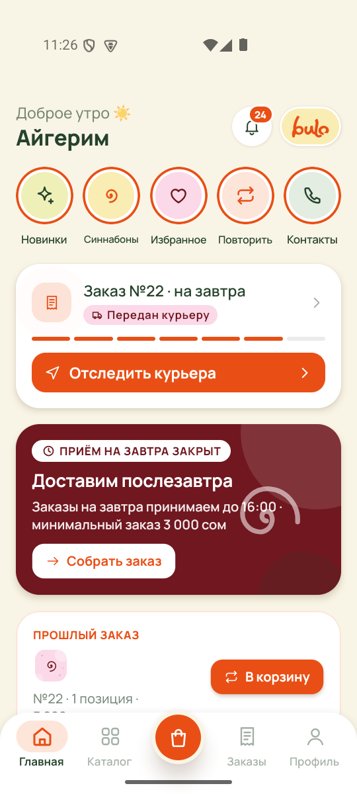
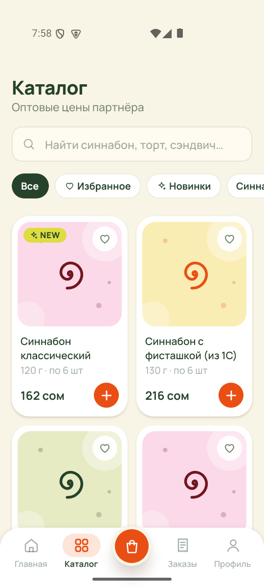
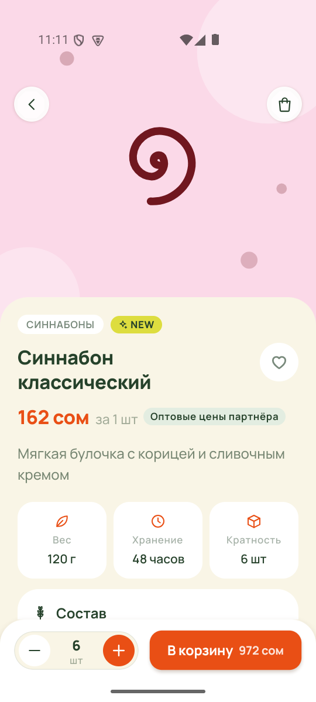
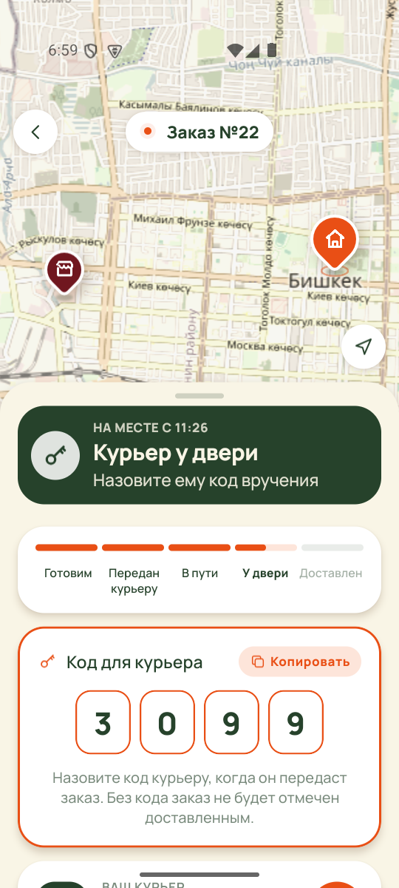
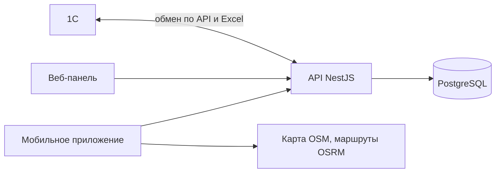
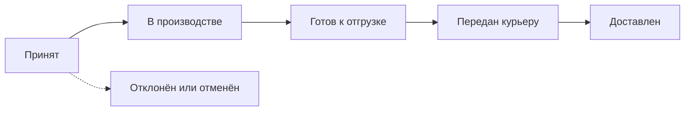

<div align="center">


### Система заказов для пекарни BULO

Партнёры заказывают выпечку, цех готовит, курьер везёт, бухгалтер ведёт оплаты, данные уходят в 1С.


[Экраны](#экраны) · [Состав](#из-чего-состоит) · [Заказ](#путь-заказа) · [Запуск](#запуск) · [APK](#сборка-apk) · [Перед запуском в работу](#перед-запуском-в-работу)

</div>

## Экраны

<table>
  <tr>
    <td align="center"><br /><sub>Главная</sub></td>
    <td align="center"><br /><sub>Каталог</sub></td>
    <td align="center"><br /><sub>Товар</sub></td>
    <td align="center"><br /><sub>Доставка</sub></td>
  </tr>
</table>

## Из чего состоит

| Часть | Папка | Технологии | Кто пользуется |
|---|---|---|---|
| Мобильное приложение | `apps/mobile` | Expo, React Native, expo-router | Партнёры, гости, курьер, цех |
| Веб-панель | `apps/admin` | Next.js | Администратор, менеджер, бухгалтер, цех |
| API | `apps/api` | NestJS, Prisma, PostgreSQL | Всё выше и 1С |
| Общие справочники | `packages/shared` | TypeScript | Роли, статусы, цвета бренда |



## Роли

| Роль | Что делает |
|---|---|
| Гость без входа | Смотрит каталог, цены скрыты |
| Партнёр (лавка) | Подаёт заявку, после одобрения видит цены, оформляет заказы, следит за статусом |
| Гость с логином | Логин и пароль выдаёт админ. Видит цены, заказы только с разрешения админа, доступ со сроком |
| Администратор | Всё: доступы и роли, партнёры, каталог, настройки |
| Менеджер | Следит за заказами партнёров, правит или отклоняет их до начала производства, работает с партнёрами и каталогом |
| Бухгалтер | Отмечает оплату, накладные, отчёты, выгрузка в 1С |
| Цех | Сводная накладная на дату, отметка «готово» |
| Курьер | Забирает готовые заказы, ведёт доставку, отмечает вручение |
| Кассир | Добавляет и убирает товары, меняет фото и розничные цены |
| Клиент (B2C) | Появится позже |

## Путь заказа



Что уходит в 1С ([подробно](docs/1c-exchange.md)):

- Новый заказ сразу создаёт документ «Заказ клиента».
- Сводная накладная цеха создаёт «Заказ на производство». Повторная накладная на ту же дату считается дозаказом.
- Передача курьеру создаёт «Реализация товаров и услуг».

Одобрения менеджером нет: заказ партнёра сразу уходит в цех. Менеджер следит за заказами и может поправить или отклонить заказ, пока его не начали готовить.

**Доставка** своя: курьер работает в приложении, партнёр видит его на карте. Код вручения не нужен, курьер отмечает вручение одной кнопкой.

**Оплата** отмечается бухгалтером отдельно и не влияет на статус: цех готовит, не дожидаясь оплаты. Способ оплаты ещё не выбран, поле свободное.

**Цены.** Партнёрские цены (типы «Базовая» и «Оптовая») ведут админ и менеджер. Розничные цены для покупателей ведёт кассир.

## Запуск

Нужны Node.js 22 и Docker.

```bash
npm install
npm run db:up                                  # PostgreSQL в Docker на порту 5433
cp apps/api/.env.example apps/api/.env         # задайте ADMIN_PASSWORD, JWT_SECRET, ONEC_API_KEY
npm run build -w @bulo/shared
cd apps/api && npx prisma migrate deploy && SEED_DEMO=true npx prisma db seed && cd ../..
npm run api:dev                                # http://localhost:4000/api
npm run admin:dev                              # http://localhost:3000
cd apps/mobile && npm install && npx expo start
```

При `SMS_PROVIDER=console` и `DEV_RETURN_OTP=true` код из СМС пишется в лог API и возвращается в ответе, так что вход работает без настоящих СМС.

Приложение само находит API на том же компьютере, где запущен `expo start`: в Expo Go, в эмуляторе Android и в браузере. `EXPO_PUBLIC_API_URL` нужен только для другого сервера.

### Демо-доступы

Создаются с `SEED_DEMO=true` и нужны только для разработки.

| Логин | Пароль | Роль |
|---|---|---|
| `admin` | значение `ADMIN_PASSWORD` из `.env` | Администратор |
| `partner` | `bulo2026` | Партнёр «Кофейня «Утро»» |
| `manager` | `bulo2026` | Менеджер |
| `accountant` | `bulo2026` | Бухгалтер |
| `workshop` | `bulo2026` | Цех |
| `courier` | `bulo2026` | Курьер |
| `cashier` | `bulo2026` | Кассир |
| `client` | `bulo2026` | Клиент |
| `guest` | `guest123` | Гость с логином |

### Живая доставка без поездки

Симулятор ведёт курьера по маршруту и шлёт геопозицию, как настоящий телефон:

```bash
ADMIN_PASSWORD=... node scripts/courier-simulator.mjs --prepare   # создать заказ и довести до отгрузки
node scripts/courier-simulator.mjs --speed=8                      # забрать заказы и поехать
node scripts/courier-simulator.mjs --deliver                     # доехать и вручить
```

### Эмулятор Android

На Windows есть виртуальный телефон `BULO_Pixel` с Expo Go. После `npx expo start` запустите в PowerShell:

```powershell
powershell -ExecutionPolicy Bypass -File scripts\android-emulator.ps1
```

### Каталог из КП

Товары, партнёрские цены и фото из коммерческого предложения лежат в `apps/api/prisma/catalog/`. Загрузить или обновить их в базе:

```bash
npm run catalog:import -w apps/api
```

Скрипт можно запускать повторно: товары находятся по названию, старые демо-товары скрываются.

## Сборка APK

Инструкция, настройка под нехватку памяти и подключение телефона через туннель: [docs/android-apk.md](docs/android-apk.md).

## Тесты

```bash
npm test
```

## Структура

```text
apps/
  api/        NestJS: заказы, каталог, доставка, производство, отчёты, обмен с 1С
  admin/      Next.js: веб-панель
  mobile/     Expo: приложение для всех ролей
packages/
  shared/     роли, статусы, цвета бренда
scripts/      симуляторы курьера и 1С, запуск эмулятора
brand/        логотип и материалы брендбука
docs/         обмен с 1С, сборка APK, скриншоты
```

## Перед запуском в работу

- [ ] **Сервер**: разместить API и базу, задать `EXPO_PUBLIC_API_URL`, выключить `DEV_RETURN_OTP`
- [ ] **Секреты**: заменить `JWT_SECRET`, `ONEC_API_KEY` и пароль администратора на новые значения
- [ ] **СМС-шлюз**: `apps/api/src/auth/sms.service.ts`, переменная `SMS_PROVIDER`
- [ ] **Защита от перебора**: ограничить частоту запросов на вход и отправку кодов
- [ ] **Оплата**: после решения заказчика
- [ ] **Карты**: платные тайлы и маршруты вместо публичных OSM и OSRM
- [ ] **Push-уведомления**: проект в Expo (EAS) и `projectId` в `apps/mobile/app.json`
- [ ] **Шрифт Apparat**: нужна лицензия на приложение, пока используется Manrope
- [ ] **1С**: см. [docs/1c-exchange.md](docs/1c-exchange.md)
- [ ] **Публикация**: свой ключ подписи, аккаунты Apple Developer и Google Play

---

<sub>Закрытый проект. Все права защищены.</sub>
